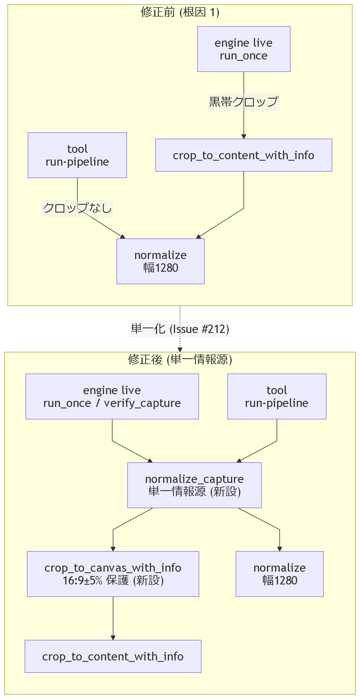
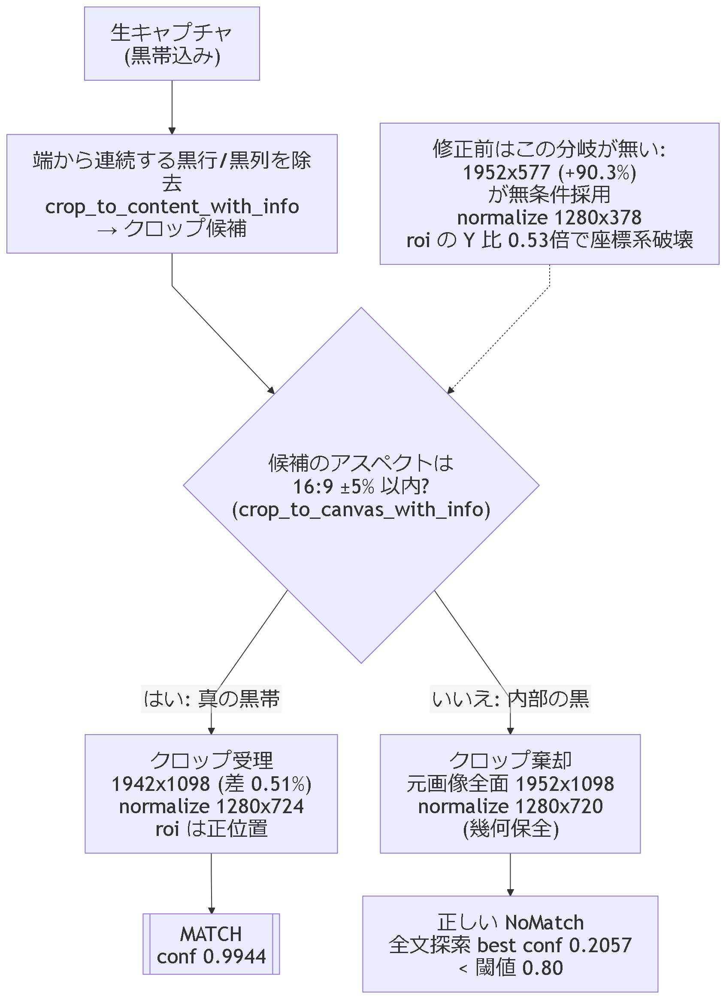

<!-- 想定読者: Issue #212 の起票者 (owner)。issue 本文・座標系の依存構造は既知のため再説明しない。
     省いたもの: テンプレートマッチングの一般論、MAA 流 720p 基準座標系の説明、#209/#210 の経緯。 -->

この PR は、capture 幾何ドリフトで roi 座標系が壊れる問題 (Issue #212) を、**前処理の単一化**と**キャンバス アスペクト保護**の 2 点で潰します。マージされると、offline 再現 (`anaden-tool run-pipeline`) と engine live 経路の認識結果が前処理の差で乖離しなくなり、起動途中フレームなどキャンバス内部に黒を含むキャプチャでクロップが座標系を破壊しなくなります。

| 節 | 役割 | 見せるもの |
|---|---|---|
| 何が変わるか | 2 つの修正が何を保証するか | 図 1 |
| 仕組み | 根因 2 層と guard の判定 | 図 2・コード |
| 実測 | 修正前後の経路比較と寸法 | staged example の生出力 |
| テスト | 挙動 pin の機械保証 | nextest 出力 |
| 受け入れ基準 | issue の AC 4 件との対応 | 表 |

## 何が変わるか

1. **offline 再現が本番と一致する**: `anaden-tool run-pipeline` が engine live 経路 (`PipelineDriver::run_once` / `verify_capture`) と同一の前処理 `ScreenScaler::normalize_capture` を呼ぶ。両経路の前処理は関数として単一化され、テストで pin される (AC-1)。
2. **キャンバス内部の黒で座標系が壊れなくなる**: 黒帯クロップに 16:9 ±5% のアスペクト保護 (`crop_to_canvas_with_info`) を追加。起動途中フレームの未描画領域 (実測: 1952x1098 の下 519 行が純黒) を黒帯と誤判定して 1952x577 に crop → 1280x378 → roi の Y 比 0.53 倍、という幾何破壊経路を棄却する (AC-3)。



修正前は tool 経路だけ黒帯クロップをスキップしていた (図 1 上段の「クロップなし」辺)。このため offline 再現と live で roi の当たり方が異なり、再現判定を信用できなかった。

## 仕組み

### 根因 1: 前処理の経路乖離 → 単一情報源

`normalize_capture` が「黒帯クロップ (アスペクト保護付き) → 幅 1280 正規化」を 1 関数に束ね、engine と tool の両方が呼ぶ。

<!-- source: ../../../crates/anaden-vision/src/scale.rs -->
```rust
    pub fn normalize_capture(&self, raw: &DynamicImage) -> (DynamicImage, CropInfo) {
        let (cropped, info) = crate::letterbox::crop_to_canvas_with_info(raw);
        (self.normalize(&cropped), info)
    }
```

### 根因 2: キャンバス内部の黒 → アスペクト保護

`crop_to_content_with_info` は「端から連続する黒行/黒列」しか見ないため、**端に接している**キャンバス内部の黒 (未描画の下半分) を真の黒帯と区別できない。guard はクロップ結果のアスペクト比で弁別する: 真の黒帯除去後は 16:9 に近く (健全実測 1942x1098 = 差 0.51%)、内部黒の誤 crop は大きく崩れる (1952x577 = +90.3%)。



<!-- source: ../../../crates/anaden-vision/src/letterbox.rs -->
```rust
    let aspect = f64::from(info.width) / f64::from(info.height);
    let deviation = ((aspect - CANVAS_ASPECT) / CANVAS_ASPECT).abs();
    if deviation <= CANVAS_ASPECT_TOLERANCE {
        (cropped, info)
    } else {
        (img.clone(), CropInfo::full(w, h))
    }
```

棄却時は元画像全面 (= キャンバス) を返すため座標系は保たれ、needle が存在しないフレームには正しく NoMatch を返す (誤マッチではなく、リトライ/リカバリに委ねる fail-safe)。

## 実測 — 修正前後の経路比較 (staged example)

新設 example `issue212_staged` は 1 枚のショットを 4 経路 (A: 無前処理 / B: 素の黒帯クロップ / C: `normalize_capture` = 本番 / D: 旧 tool 相当) に通して突き合わせる。以下は repo に tract された 2 つの実 fixture の生出力。

**過渡ブートフレーム** (Issue #212 の障害フレーム・下 519 行が未描画純黒):

<!-- output: staged-degenerate -->
```text
shot: 1952x1098 "crates/anaden-vision/tests/fixtures/title_boot_degenerate_1952x1098.png"
profile: rows with mean>=8: first=Some(0) last=Some(578) (h=1098; bottom black rows = 519)
[A raw] frame=1952x1098 roi=Some([604, 223, 160, 180]) thr=0.8: None | best(full-scan): conf=0.2046 at (806,31) 186x186
B crop_to_content: offset=(0,0) size=1952x577
[B crop-only] frame=1952x577 roi=Some([604, 223, 160, 180]) thr=0.8: None | best(full-scan): conf=0.3080 at (180,6) 186x98
C normalize_capture: content 1952x1098 (offset 0,0) -> 1280x720
[C normalize_capture (production)] frame=1280x720 roi=Some([604, 223, 160, 180]) thr=0.8: None | best(full-scan): conf=0.2057 at (529,21) 122x122
[D normalize-only (pre-#212 tool)] frame=1280x720 roi=Some([604, 223, 160, 180]) thr=0.8: None | best(full-scan): conf=0.2057 at (529,21) 122x122
```

B が罠の実測 (1952x577)。C は guard がクロップを棄却して全面のまま 1280x720 に正規化し、roi は正しい座標系で評価されて NoMatch — このフレームには needle が存在しない (全文探索 best 0.2057 < 閾値 0.80) ため、これが正解。

**健全タイトル画面** (#208 由来の実ショット・左 8px 黒帯):

<!-- output: staged-healthy -->
```text
shot: 1952x1098 "crates/anaden-vision/tests/fixtures/title_live_1952x1098.png"
profile: rows with mean>=8: first=Some(0) last=Some(1097) (h=1098; bottom black rows = 0)
[A raw] frame=1952x1098 roi=Some([604, 223, 160, 180]) thr=0.8: conf=0.9856 at (976,406) 186x186 | best(full-scan): conf=0.9856 at (976,406) 186x186
B crop_to_content: offset=(10,0) size=1942x1098
[B crop-only] frame=1942x1098 roi=Some([604, 223, 160, 180]) thr=0.8: conf=0.9822 at (967,406) 185x186 | best(full-scan): conf=0.9822 at (967,406) 185x186
C normalize_capture: content 1942x1098 (offset 10,0) -> 1280x724
[C normalize_capture (production)] frame=1280x724 roi=Some([604, 223, 160, 180]) thr=0.8: conf=0.9944 at (637,268) 122x123 | best(full-scan): conf=0.9944 at (637,268) 122x123
[D normalize-only (pre-#212 tool)] frame=1280x720 roi=Some([604, 223, 160, 180]) thr=0.8: conf=0.9753 at (640,267) 122x122 | best(full-scan): conf=0.9753 at (640,267) 122x122
```

健全幾何では真の黒帯 (1942x1098 = 差 0.51% ≤ 5%) は受理され、C 経路の roi 付き detect が conf 0.9944 で MATCH する。

本文・図で使う寸法計算 (pin 値 1952x577 / 1942x1098 から機械再計算):

<!-- output: aspect-calc -->
```text
degenerate crop 1952x577: aspect=3.383 deviation=+90.3%
unguarded normalize height: 577*1280/1952 = 378 → 1280x378
roi Y factor: 378/708 = 0.53
healthy crop 1942x1098: deviation=0.51% (tolerance 5%)
```

## テスト — 挙動の pin

回帰テスト (anaden-vision・新規) は (a) 素クロップが幾何を壊すこと (罠の pin)、(b) `normalize_capture` が 1280x720 を維持すること (幾何保全)、(c) roi 付き detect が正しく NoMatch を返すことを 1 テストで保証する。engine 側は実 asset (実キャプチャ fixture + 実 login pipeline TOML) で end-to-end を pin する: 健全 fixture は `Tap { x: 1423, y: 746 }` (rescale 済み実機生座標) で Fired、過渡 fixture は `CropInfo::full(1952, 1098)` のまま NoMatch。

<!-- output: vision-regression -->
```text
(1/2) anaden-vision::geometry_drift_regression degenerate_boot_frame_preserves_geometry_and_reports_nomatch
(2/2) anaden-vision::geometry_drift_regression healthy_title_geometry_and_degenerate_geometry_both_green
2 tests run: 2 passed, 0 skipped
```

<!-- output: engine-pins -->
```text
(1/2) anaden-engine pipeline_driver::tests::run_once_on_degenerate_frame_keeps_canvas_geometry
(2/2) anaden-engine pipeline_driver::tests::run_once_fires_on_real_title_fixture_through_guarded_preprocessing
2 tests run: 2 passed, 139 skipped
```

## 受け入れ基準 (Issue #212) との対応

| AC | 判定 | 根拠 |
|---|---|---|
| 1. run-pipeline が engine live 経路と同一の前処理 (テストで pin) | ✅ | 両経路が `ScreenScaler::normalize_capture` を呼ぶ (`template_tool.rs` / `pipeline_driver.rs`)。engine pin テスト・`title_live_regression` が同関数前提で green |
| 2. 現在の実キャプチャで roi 付き pipeline がマッチ | ⚠️ 要再解釈 | 現行 fixture (capture_probe 由来) は起動途中の過渡フレームで needle が不在 — C 経路全文探索 best conf 0.2057 < 0.80 のため「マッチしない」が正。健全幾何 (#208 fixture) は conf 0.9944 で MATCH。起票時の「全文探索 89% MATCH」は SSE 偽陽性 (既存 PR #213 の gate 済み診断による) |
| 3. 幾何が変化しても壊れない構造 (または検出して警告) | ✅ | `crop_to_canvas_with_info` の 16:9 ±5% guard + `geometry_drift_regression` (罠 pin・幾何保全・対比保証) |
| 4. 実機: タイトル画面で login 発火 1 以上 | ❌ 未検証 | 本 PR の検証は offline のみ。実機確認は別 verify run が必要 |

## 影響範囲と残リスク

- guard の 16:9 前提は **PC 版キャンバス限定**。旧 Android 実機バックエンドは Issue #188 で削除済みのため現状の影響は無いが、将来 20:9 縦長端末経路を復活させる場合は guard の前提を見直す必要がある。
- 過渡フレームは引き続き NoMatch (発火しない)。誤マッチしない方向の fail-safe であり、遷移はリトライ/リカバリに委ねる。
- `MARGIN_PX`・閾値 (8.0 / 64px / 5%) は従来値のまま。5% は健全実測 0.51% と破壊実測 +90.3% の中間に十分広く置いた閾値 (両群の弁別 margin は約 10 倍)。

## 差分 (説明順)

1. `crates/anaden-vision/src/letterbox.rs` — `crop_to_canvas_with_info` (guard)・`CANVAS_ASPECT`/`CANVAS_ASPECT_TOLERANCE` 追加 + 単体テスト
2. `crates/anaden-vision/src/scale.rs` — `ScreenScaler::normalize_capture` (単一情報源) + テスト
3. `crates/anaden-vision/src/lib.rs` — 新 API の export
4. `crates/anaden-engine/src/pipeline_driver.rs` — `run_once`/`verify_capture` を `normalize_capture` へ + 実 asset pin テスト 2 件
5. `crates/anaden-cli/src/template_tool.rs` — `run-pipeline` を `normalize_capture` へ (AC-1)
6. `crates/anaden-vision/tests/geometry_drift_regression.rs` + `tests/fixtures/title_boot_degenerate_1952x1098.png` — 回帰テストと障害フレーム fixture
7. `crates/anaden-vision/examples/issue212_staged.rs` — 4 経路比較の診断 example
8. `crates/anaden-vision/tests/title_live_regression.rs`・`pipeline.rs` (テスト)・`anaden-studio/examples/authoring_demo.rs` — 前処理呼び替え (挙動は pin 済み)

## 理解度チェック

<details>
<summary>3 問 (クリックで回答)</summary>

1. **`anaden-tool run-pipeline` と engine live 経路の前処理は、この PR の後どう違う?**
   → 違いなし。両方とも `ScreenScaler::normalize_capture` (アスペクト保護付き黒帯クロップ → 幅 1280 正規化) を呼び、テストで pin されている。
2. **起動途中フレーム (下 519 行が純黒) で guard は何を返し、detect は何を返すか?**
   → guard は 1952x577 へのクロップを棄却して全面 (`CropInfo::full(1952, 1098)`) を返し、normalize は 1280x720。detect は needle が不在のため NoMatch (これが正解)。
3. **真の黒帯 (左 8px・crop 後 1942x1098) が棄却されない理由は?**
   → 1942x1098 の 16:9 からの偏差が 0.51% で、許容 5% 以内のため受理。棄却されるのは +90.3% に崩れる内部黒由来のクロップのみ。

</details>

---

- 図の検証: `figure-check.mjs` (重なり・はみ出し・枠越え・線と文字の交差・9px 未満文字・事実シート照合) 両図 CLEAN。目視シート確認は本環境で画像プレビュー不可のため未実施 (機械検査のみ)。
- 本文の出力引用は `docs/explainers/issue212-pr/checks.json` のコマンド再実行で照合される (`verify-doc.mjs`)。

Co-Authored-By: glm 4.7 <noreply@zhipuai.cn>
